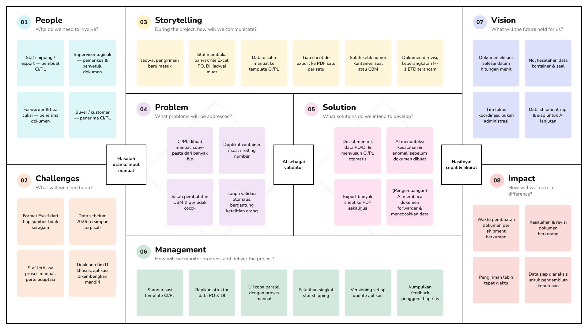

# Dockit: Otomasi Dokumen Ekspor Berbantuan AI

> Tugas Kelompok 5: **Design Thinking dan Solusi Digital Berbasis AI (Ideasi & Prototyping)**

Dockit adalah aplikasi desktop Windows yang menyusun dokumen ekspor **Commercial Invoice (CI)** dan **Packing List (PL)** secara otomatis dari banyak file Excel, memvalidasi datanya dengan bantuan AI, lalu mengekspornya ke PDF sekaligus.

Proyek ini berangkat dari masalah nyata di departemen shipping. Kami menyelesaikannya dengan metode **Design Thinking**, dan hasilnya dituangkan dalam **Design Thinking Canvas**.

---

## Daftar Isi

- [Anggota Kelompok](#anggota-kelompok)
- [Latar Belakang](#latar-belakang)
- [Design Thinking Canvas](#design-thinking-canvas)
- [Proses Design Thinking](#proses-design-thinking)
- [Fitur Solusi](#fitur-solusi)
- [Peran AI](#peran-ai)
- [Struktur Repository](#struktur-repository)
- [Rencana Pengembangan](#rencana-pengembangan)

---

## Anggota Kelompok

| No | Nama | NIM |
|----|------|-----|
| 1 | Andrean | 2025122034 |
| 2 | Augustian Gautama | 2023131006 |
| 3 | Sanni Oktavia | 2023131008 |
| 4 | Canniago Verrian | 2023131012 |
| 5 | Ferry Govert Anwar | 2023131019 |
| 6 | Jeselyn | 2025122004 |
| 7 | Leonis Leonaneta | 2025122021 |
| 8 | Junifer Tan Singbee | 2025122042 |
| 9 | Evelyn Itan | 2025122053 |
| 10 | Runa | 2025122057 |
| 11 | Michelle | 2025122062 |

**Mata Kuliah:** [NAMA MATA KULIAH]
**Dosen Pengampu:** Yodi
**Universitas:** Universitas Universal, Batam

---

## Latar Belakang

Setiap kali ada pengiriman, staf shipping harus menyalin data dari banyak file Excel (PO, DI, jadwal muat) ke template CI/PL, lalu mengubah tiap sheet menjadi PDF satu per satu. Prosesnya berulang dan memakan waktu.

Satu salah ketik pada nomor kontainer, nomor seal, atau CBM membuat dokumen harus direvisi. Padahal kontainer berangkat **H-1 sebelum ETD**, sehingga setiap revisi berisiko menunda pengiriman.

---

## Design Thinking Canvas



| Bagian | Isi |
|--------|-----|
| **01 People** | Staf shipping/export (pembuat CI/PL) · Supervisor logistik (pemeriksa & penyetuju) · Forwarder & bea cukai (penerima dokumen) · Buyer/customer (penerima CI/PL) |
| **02 Challenges** | Format Excel dari tiap sumber tidak seragam · Data sebelum 2026 tersimpan terpisah · Staf terbiasa proses manual · Tidak ada tim IT khusus |
| **03 Storytelling** | Jadwal pengiriman masuk → staf membuka banyak file Excel → data disalin manual ke template → tiap sheet di-export ke PDF satu per satu → salah ketik nomor kontainer/seal/CBM → dokumen direvisi, keberangkatan H-1 ETD terancam |
| **04 Problem** | CI/PL dibuat manual dari banyak file · Duplikat container/seal/rolling number · Salah pembulatan CBM & qty tidak cocok · Tidak ada validasi otomatis |
| **05 Solution** | Menarik data PO/DI & menyusun CI/PL otomatis · AI mendeteksi kesalahan & anomali · Export banyak sheet ke PDF sekaligus · AI membaca dokumen forwarder (pengembangan) |
| **06 Management** | Standarisasi template CI/PL · Rapikan struktur data PO & DI · Uji coba paralel dengan proses manual · Pelatihan staf · Versioning tiap update · Feedback pengguna tiap rilis |
| **07 Vision** | Dokumen ekspor selesai dalam hitungan menit · Nol kesalahan data kontainer & seal · Tim fokus pada koordinasi, bukan administrasi · Data shipment siap untuk AI lanjutan |
| **08 Impact** | Waktu pembuatan dokumen berkurang · Kesalahan & revisi berkurang · Pengiriman lebih tepat waktu · Data siap dianalisis |

---

## Proses Design Thinking

| Tahap | Yang Dilakukan |
|-------|----------------|
| **1. Empathize** | Mengamati alur kerja staf shipping saat menyiapkan dokumen CI/PL untuk setiap pengiriman |
| **2. Define** | Merumuskan masalah inti: pembuatan dokumen yang manual dan tanpa validasi menyebabkan kesalahan dan keterlambatan |
| **3. Ideate** | Brainstorming solusi: template baku, makro Excel, sampai aplikasi otomasi dengan validasi berbasis AI |
| **4. Prototype** | Membangun Dockit sebagai aplikasi desktop yang membaca file Excel dan menghasilkan CI/PL dalam PDF |
| **5. Test** | Uji coba Dockit secara paralel dengan proses manual pada pengiriman nyata, lalu iterasi berdasarkan feedback |

---

## Fitur Solusi

- **Penyusunan dokumen otomatis.** Menarik data dari banyak file Excel (PO & DI) dan mengisi template CI/PL.
- **Validasi data.** Mendeteksi duplikat container number, seal number, dan rolling number.
- **Aturan bisnis bawaan.** CBM selalu dibulatkan ke bawah, dan tanggal keberangkatan dihitung H-1 dari ETD.
- **Export PDF massal.** Mengubah banyak sheet terpilih dari banyak file (termasuk ZIP) menjadi PDF sekaligus, lengkap dengan preview.
- **Kalender ETD.** Menampilkan jadwal per BL (hari berangkat H-1 dan ETD), dikelompokkan per port of discharge.
- **Update NW/GW.** Memperbarui berat bersih dan kotor dari file timbang, atau memperkirakannya bila belum ditimbang.
- **Versioning.** Setiap update aplikasi diberi nomor versi baru.

---

## Peran AI

| Fitur AI | Fungsi | Status |
|----------|--------|--------|
| Deteksi anomali data | Menandai nilai yang tidak wajar (qty, berat, CBM) dibandingkan pola pengiriman sebelumnya | Direncanakan |
| Pembacaan dokumen (OCR + LLM) | Membaca dokumen masuk dari forwarder (PDF/scan) dan mencocokkannya dengan data internal | Direncanakan |
| Pemetaan kolom otomatis | Mengenali kolom dari file Excel yang formatnya berbeda-beda | Direncanakan |

---

## Struktur Repository

```
litek-kelomok-5/
├── README.md
├── docs/                            # Dockit Web (GitHub Pages)
│   ├── index.html
│   ├── assets/                      # app.js, style.css, font, library (SheetJS, JSZip)
│   ├── sample/contoh-data-dockit.xlsx   # Data contoh fiktif
│   └── design-thinking-canvas.png   # Hasil Design Thinking Canvas
└── app/                             # Source code Dockit V1.28
    ├── dockit.pyw                   # Aplikasi utama (convert Excel → PDF)
    ├── di_ui.py                     # Halaman data DI & pembuat Excel
    ├── di_data.py                   # Baca/simpan file sumber, pengecekan data
    ├── calendar_page.py             # Kalender ETD per BL
    ├── dockit_motion.py             # Animasi antarmuka
    ├── dockit_icons.py              # Ikon (Lucide / Moving Icons, MIT)
    ├── po_template.xlsx             # Template CI/PL PO (data contoh)
    ├── di_template.xlsx             # Template CI/PL DI (data contoh)
    ├── icons/                       # Aset ikon
    ├── Install.bat / install.ps1    # Installer Windows
    └── uninstall.ps1
```

> **Catatan:** semua data perusahaan, customer, alamat, email dan rekening di kedua template sudah diganti dengan data contoh fiktif.

---

## Dockit Web

**Coba langsung:** https://augustian17.github.io/litek-kelomok-5/

Versi browser Dockit untuk tim shipping, di-hosting gratis di GitHub Pages (folder `docs/`).

- **Login khusus karyawan** dengan animasi pembuka kapal kontainer (desain glassmorphism).
- **Tambah File:** tarik file master DI, file loading, dan file data barang (Excel atau ZIP). Tersedia tombol *Coba dengan data contoh*.
- **Cek Data:** mendeteksi Rolling, Kontainer, atau Seal yang dobel, kolom wajib kosong, NW/GW atau HS Code yang belum ada, CBM/Qty yang tidak tally, serta anomali berat (GW/CBM) dibanding kontainer seukuran.
- **Asisten AI:** ringkasan lokal (BL yang perlu direvisi, CBM per bulan, kontainer per POD). Untuk pertanyaan bebas, pengguna bisa memasukkan API key Claude miliknya sendiri.
- **Dokumen CI/PL:** preview Commercial Invoice dan Packing List, lalu unduh sebagai PDF atau Excel.
- **Kalender ETD:** setiap BL tampil di hari berangkat (H-1) dan hari ETD, diwarnai per POD.

**Privasi:** semua file diproses di browser dan tidak pernah dikirim ke server. Pengecualiannya hanya Asisten AI, dan itu pun hanya bila pengguna memasukkan API key Claude.

> **Mode demo:** login saat ini dicek di browser (akun `demo@dockit.app` / `Dockit2026!`). Ini **bukan** pengamanan sungguhan karena kodenya publik. Untuk dipakai sungguhan, login perlu dihubungkan ke layanan seperti Firebase Authentication atau Supabase Auth.

---

## Menjalankan Dockit

**Kebutuhan:** Windows, Python 3, dan Microsoft Excel atau WPS Spreadsheets.

1. Buka folder `app/`.
2. Jalankan **`Install.bat`**. Installer akan memasang dependensi (`pywin32`, `customtkinter`, `pypdfium2`, `pillow`, `lxml`, `tkinterdnd2`, `openpyxl`) dan membuat shortcut Dockit.
3. Buka Dockit dari shortcut, atau jalankan langsung:

```bash
pip install pywin32 customtkinter pypdfium2 pillow lxml tkinterdnd2 openpyxl
pythonw app/dockit.pyw
```

---

## Rencana Pengembangan

- [x] Design Thinking Canvas
- [x] Prototype Dockit V1.28 (generate CI/PL, export PDF, validasi data, kalender ETD)
- [x] Wireframe / mockup antarmuka Dockit Web
- [x] Dockit Web 1.0 di GitHub Pages (mode demo)
- [ ] Login sungguhan (Firebase / Supabase)
- [ ] Prototype fitur deteksi anomali berbasis AI
- [ ] Pengujian dengan pengguna (staf shipping)
- [ ] Presentasi hasil

---

<p align="center">Kelompok 5 · Universitas Universal · 2026</p>
